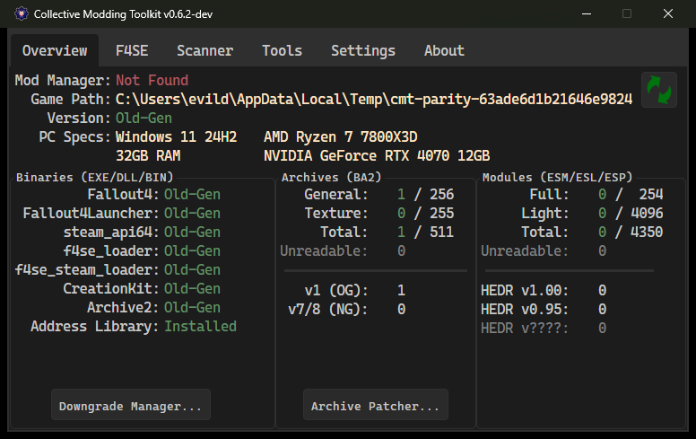
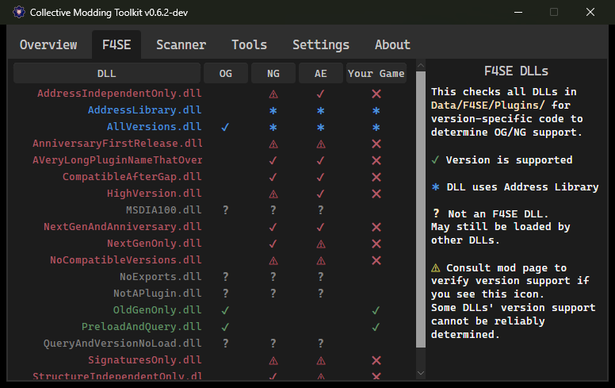
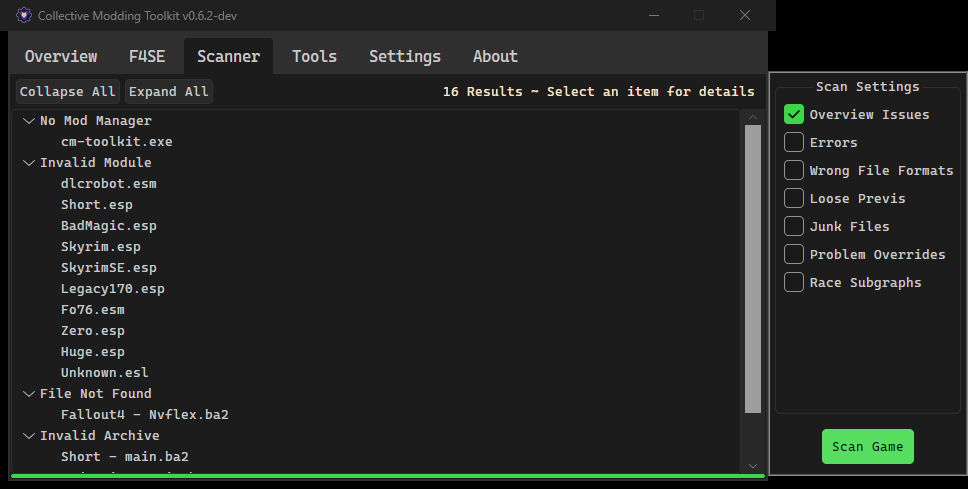
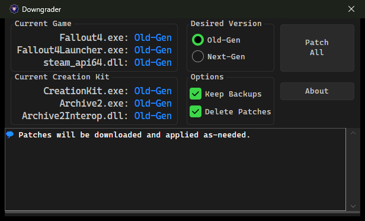
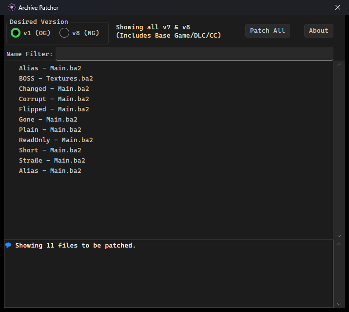

# Collective Modding Toolkit

Latest Version: [Download](https://github.com/evildarkarchon/Collective-Modding-Toolkit/releases/latest/download/cm-toolkit.7z) – [Release Notes](https://github.com/evildarkarchon/Collective-Modding-Toolkit/releases/latest)

A toolkit for troubleshooting and optimizing your mod setup for Fallout 4, purpose-built for the [Collective Modding Discord](https://discord.gg/tktyEyYHZH) Community.

## Credits

The Collective Modding Toolkit was created by **wxMichael** ([wxMichael/Collective-Modding-Toolkit](https://github.com/wxMichael/Collective-Modding-Toolkit)) as a Python app.
**RowanSkie** forked it ([RowanSkie/Collective-Modding-Toolkit](https://github.com/RowanSkie/Collective-Modding-Toolkit)) to support Anniversary Edition and its raised BA2 limits.
This fork, by **evildarkarchon**, ports RowanSkie's fork to C# and Avalonia and publishes the releases, starting with 0.7.0.
The Python app is preserved in this repository's history at the `python-reference` tag.

## Features

- Downgrades and upgrades Fallout 4 and Creation Kit between Old-Gen and Next-Gen with delta patches.
- Provides counts of data files by type; plugins (Full/Light) and BA2 (General and Textures)
- Patches all BA2 files to either v1 (OG) or v8 (NG)
- Scans F4SE DLLs for game version support
- Scans your mod setup for potential issues.

Suggestions and feedback welcome. Features are prioritized based on the needs of the Collective Modding Community.  
[Join on Discord](https://discord.gg/tktyEyYHZH) and look for the **#🔧-cm-toolkit** channel.

## Installation

1. Download [`cm-toolkit.7z`](https://github.com/evildarkarchon/Collective-Modding-Toolkit/releases/latest/download/cm-toolkit.7z).
2. Extract it anywhere. Everything in it is under `Tools\CM-Toolkit\`: `cm-toolkit.exe`, the native DLLs it needs, and
   its license files. No .NET runtime needs to be installed.
3. Add `Tools\CM-Toolkit\cm-toolkit.exe` to your mod manager's executables.
4. Launch via your mod manager.

**Upgrading from 0.6.x:** extract the archive over your existing install. The folder layout is the same, and your
`settings.json` carries over.

The toolkit keeps `settings.json`, `cm-toolkit.log` and downloaded delta patches beside `cm-toolkit.exe`. If it can't
write there, as under `Program Files`, it uses `%LOCALAPPDATA%\CM-Toolkit` instead.

## Screenshots

## Building

See [`dotnet/README.md`](dotnet/README.md).
